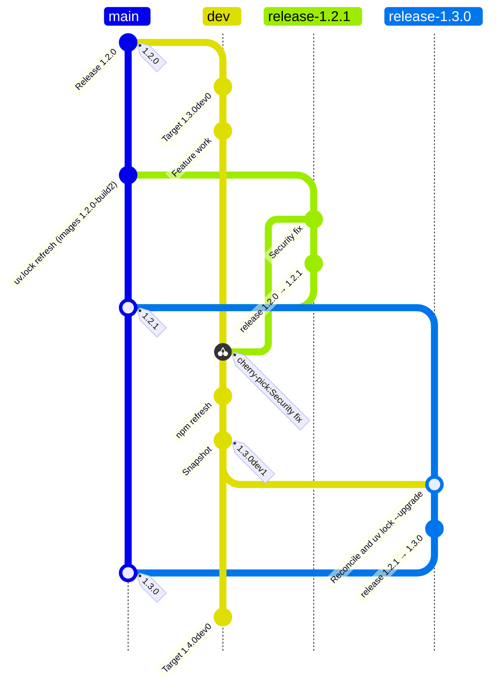

# About Versioned Releases

Dioptra's version numbers tell users how much a release changes the platform they work with. Container images add a second dimension of change, because their operating system and locked Python dependencies need refreshing even when the application stays the same. This article explains how the project decides what kind of release a change needs, how the `main` and `dev` branches carry that work, and why container images have build numbers in addition to package versions.

The [release and maintenance policy](release-and-maintenance-policy.md) states the rules, and the [workflow and metadata reference](release-workflow-reference.md) describes the GitHub Actions workflows that publish releases. The [implementation status](release-policy-implementation-status.md) tracks which rules are currently in effect.

## Version increments

A package version such as `1.2.1` identifies the backend source, the built frontend, and the dependency requirements published in `pyproject.toml` for the `dioptra-platform` package. A change to any of these needs a new package version.

Dioptra uses major, minor, and patch increments, but it does not apply semantic versioning strictly. Under strict semantic versioning, any change that could break an existing script requires a new major version. For example, the 1.2.0 release removed the `workflows/validateEntrypoint` endpoint and added required fields to entrypoint update requests, and the 1.2.1 release restricted repository imports to public HTTPS archives on GitHub and GitLab. Strictly applied, those two releases would have been 2.0.0 and 3.0.0, even though neither changed how Dioptra works as a system. The project instead chooses the increment by how much a release changes the way people use the platform.

### Major versions

Dioptra 1.x is built on a core set of architectural assumptions:

-   Users write plugins as Python packages of task functions and compose them into workflows using entrypoint YAML files.
-   Bundled Docker worker containers execute those workflows.
-   The REST API and its MLflow integration manage centralized database records and artifacts, tracking file versions so that every job result links to a complete snapshot of its inputs.
-   The web client, Python client, and REST API endpoints share a consistent resource layout around these concepts.

A major version is reserved for a planned architectural break with those concepts or a fundamental change to a primary user workflow or file format. Examples include replacing bundled worker containers with a general execution protocol, decentralizing artifact storage, removing the assumption that components run in Docker, replacing entrypoint YAML without backward compatibility, or reorganizing the REST API thoroughly enough that existing client scripts stop working. Breaking changes of this scale are planned and released together rather than triggered by an isolated feature change.

### Minor versions

A minor version adds capability within the current architecture, makes an existing workflow easier, or consolidates existing features. A minor release can include incompatible changes to features outside the main user workflows. For example, entrypoint task swaps in 1.2.0 extended the entrypoint YAML format. Supporting them required removing an ad hoc validation endpoint that the backend did not enforce and adding required fields to entrypoint update requests. Because the domain model and overall API structure remained intact, 1.2.0 was a minor release.

### Patch versions

A patch corrects a flaw without adding capability. A fix can still narrow what users can do when required for security or correctness, as when 1.2.1 restricted repository imports from arbitrary Git clones to HTTPS archive downloads. Other changes that add no new user-facing capability also ship as patches when released on their own:

-   Removal of an unused or high-maintenance feature.
-   An internal refactoring that leaves user-facing behavior unchanged.
-   A database migration that fixes a bug, such as adding a missing constraint.

When a feature removal is ready at the same time as new capabilities, it ships with them in the next minor release. In either case, the content of a release determines the version increment, not the branch it originates from.

### Separate version signals

The REST API path version (`api/v1`) does not track the package version. It would change only if the endpoint resource layout were reorganized, allowing `v1` to remain available temporarily alongside `v2`.

Commit messages follow the [commit style guide](../../COMMIT_STYLE_GUIDE.md), which is based on Conventional Commits. A `BREAKING CHANGE` footer records that a commit could interrupt an existing script or workflow and helps maintainers identify changes that may need migration notes. It does not determine the version increment.

## Deprecation

Dioptra does not have a deprecation policy yet, so a removed or replaced feature ships in the next suitable release without a notice period. The project will adopt one once removing features without notice would disrupt work that depends on them, and no later than the 2.0 release.

## Release timing

Releases follow completed work rather than a calendar schedule. The development team maintains an internal project roadmap that groups planned features into milestones, and each completed milestone becomes a minor release. When features outside the roadmap accumulate on `dev`, the team can also approve a minor release once that work is complete. Major releases follow the same milestone planning at a larger scale.

Patch releases go out between minor releases for changes that should not wait, as listed in the [release policy](release-and-maintenance-policy.md#release-timing-and-approval).

## Branch life cycles

The `main` and `dev` branches have separate life cycles. The `main` branch holds the latest stable release along with ongoing maintenance, such as dependency lockfile refreshes, workflow updates, bug fixes, and corrections to released documentation. The `dev` branch integrates work for the next release. Feature branches start from `dev` and merge back into it, and the version on `dev` (such as `1.3.0dev0`) names the upcoming release that `dev` is building toward.

Most changes land on `dev` first and move to `main` in the next minor release, while urgent fixes and maintenance updates can land on `main` between minor releases. A fix can be written on `main` and carried to `dev`, or written on `dev` and cherry-picked to `main`, as long as both branches receive the same fix rather than separate implementations. Each branch also updates its own dependency lockfiles independently.

Because both branches accumulate changes between minor releases, preparing a stable release requires reconciling them on a release branch before fast-forwarding `main`.

Development snapshots (such as `1.3.0dev1`) publish work from `dev` to TestPyPI and the container registry when the team wants to test or evaluate in-progress work. They are optional and independent of stable releases on `main`.

The following diagram illustrates how `main` and `dev` can evolve between two minor releases:

In this example, the lockfile refresh on `main` triggers a new container build of `1.2.0` without changing the Python package version. A security fix ships as `1.2.1` from a release branch and is cherry-picked to `dev`.

## Dependency lockfiles

Dioptra maintains `uv.lock` for Python dependencies and `src/frontend/package-lock.json` for the web frontend.

In `pyproject.toml`, Dioptra declares compatible version ranges for its Python dependencies. When a user runs `pip install dioptra-platform`, pip resolves versions within those ranges and ignores `uv.lock`. Container images, by contrast, install their Python environment directly from `uv.lock` so that image builds are reproducible.

Both `main` and `dev` refresh `uv.lock` through reviewed pull requests. Refreshing `uv.lock` on `main` incorporates upstream security fixes into the container images and keeps the locked environment close to what a fresh `pip install` would resolve.

The frontend's `package-lock.json` has a different life cycle because the frontend builds exclusively from its lockfile and ships as compiled assets. Every npm lockfile update changes the shipped application. Routine npm dependency refreshes therefore land on `dev` and ship in the next minor release. The `main` branch updates `package-lock.json` only when a security or bug fix requires a patch release.

## Container builds

A container image packages the Dioptra application together with an operating system, system libraries, and the locked Python environment from `uv.lock`. Those underlying layers need regular security refreshes even when Dioptra's own code and `pyproject.toml` requirements have not changed. Publishing a new Python package version solely to rebuild unchanged code into new container images would create empty releases on PyPI.

To separate image refreshes from package releases, container image tags add a build number to the package version, such as `restapi:1.2.1-build3`. The package version (`1.2.1`) identifies the `dioptra-platform` package inside the image, while the build number (`build3`) identifies the container environment around it. Numbered build tags are immutable, whereas the unnumbered version tag (`restapi:1.2.1`) moves to point to the latest completed build of that package version. Using immutable build numbers lets operators and deployment tooling detect when refreshed images are available without blindly re-pulling a moving tag.

Each container build produces all seven Dioptra service images as a single unit. Because the images share base layers and Python packages, a vulnerability in one image usually affects the others, so deployments should update all services to the same build number together. Each completed build publishes a record of its image digests so tooling can discover the newest completed build for an installed package version. See [Completed-build discovery](release-and-maintenance-policy.md#completed-build-discovery) for the publication and selection rules.
